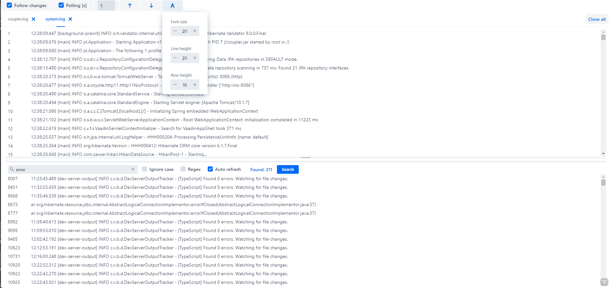

# Vaadin addon - File viewer (glogg)

This add-on is based on the popular log viewer software called glogg.

Enables:
- Viewing huge files, especially logs, without performance or ram usage loss
- Monitoring changes in displayed files and dynamically extending the content
- File search
- Dynamic extension of search results with changes in files (new entries)

Requires @Push enabled for stable and comfortable work

### Usage
```
FileViewer viewer = new FileViewer();
viewer.openFile(new File("...).toPath());
viewer.openFile(new File("...").toPath());
viewer.openFile(new File("...").toPath());
```
### Additional configuration

- You can disable/hide polling configuration and also search bar. To do that you have to pass configuration to the constructor of the FileViewer
```
        FileViewer viewer = new FileViewer(new FileViewerConfig(){

            @Override
            public boolean pollingEnabled() {
                return true;
            }

            @Override
            public int pollingInterval() {
                return 1;
            }

            @Override
            public boolean searchViewVisible() {
                return true;
            }

            @Override
            public boolean fontResizeAllowed() {
                return true;
            }
        });
```
### Layout structure

```
|---------------------------------------------------------------|
|                FileViewer - VerticalLayout                    |
|  |---------------------------------------------------------|  |
|  |              PollingMenuBar  - MenuBar                  |  |
|  |---------------------------------------------------------|  |
|  |               FileTabSheet  - TabSheet                  |  |
|  |  |---------------------------------------------------|  |  |
|  |  |               FileTab  -  Div                     |  |  |
|  |  |  |---------------------------------------------|  |  |  |
|  |  |  |          FileContentGrid - Grid             |  |  |  |
|  |  |  |---------------------------------------------|  |  |  |
|  |  |  |      FileSearchLayout - VerticalLayout      |  |  |  |
|  |  |  |  |---------------------------------------|  |  |  |  |
|  |  |  |  |       SearchBarFields - MenuBar       |  |  |  |  |
|  |  |  |  |---------------------------------------|  |  |  |  |
|  |  |  |  |        SearchResultGrid - Grid        |  |  |  |  |
|  |  |  |  |---------------------------------------|  |  |  |  |
|  |  |  |                                             |  |  |  |
|  |  |  | --------------------------------------------|  |  |  |
|  |  |---------------------------------------------------|  |  |
|  |---------------------------------------------------------|  |
|---------------------------------------------------------------|
```
Original template https://github.com/vaadin/addon-template
